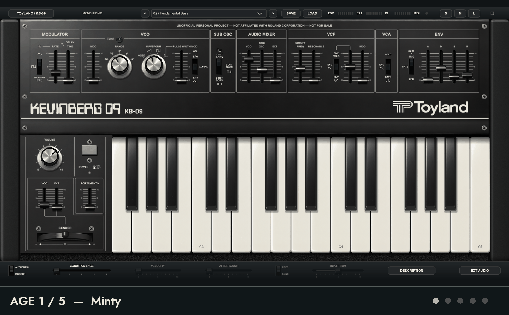

# Toyland KB-09

**A free recreation of Kevin's Roland SH-09, with a few cool extras.**

Free for everyone, forever. Make music, share it with your friends, and enjoy.

**Watch KB-09 age:** the preview below automatically cycles through all five conditions, from **Minty** to **Fire Hazard**, then repeats. AGE changes both the instrument's appearance and its sound.

**Inspect a still image:** [1 · Minty](docs/manual/assets/panel-age-1.png) · [2 · Seen Some Shit](docs/manual/assets/panel-age-2.png) · [3 · Vintage, Baby!](docs/manual/assets/panel-age-3.png) · [4 · Sold As-Is](docs/manual/assets/panel-age-4.png) · [5 · Fire Hazard](docs/manual/assets/panel-age-5.png)

## Download and play

**[Download KB-09 1.9.0](https://github.com/kevinberg84/toyland-kb09/releases/tag/v1.9.0)**

Open **Assets** on the release page and choose your operating system's ZIP. You don't need a GitHub account to download it. The automatic **Source code** archives are for building the software yourself.

| System | Included formats | Notes |
| --- | --- | --- |
| Windows 64-bit | Standalone, VST3 | ASIO, WASAPI and DirectSound |
| macOS 12 or later | Standalone, AU, VST3 | Universal Apple Silicon / Intel; ad-hoc signed, not notarized |
| Linux x86-64 | Standalone | ALSA and JACK, including PipeWire's JACK layer; physical desktop/audio/MIDI testing remains **UNVERIFIED** |

1. Download and extract the whole ZIP.
2. Open **OPEN ME FIRST!.html** and follow the instructions for your system.
3. Launch the standalone or load the plug-in in your DAW. The standalone's **AUDIO / MIDI** settings select your audio output, MIDI controller and receive channel.

Each package includes an illustrated **User Manual.html**, installation helpers and 24 factory presets. The app and included manual work offline. Unsigned-app warnings and installation steps are explained in the platform guide; don't disable your computer's security protections.

## The instrument

- Monophonic, circuit-informed sound engine inspired by SH-09 documentation and Kevin's own instrument.
- Saw, square, pulse and noise, a sub oscillator, resonant filter, envelope and LFO.
- **AUTHENTIC** and **MODERN** modes, with velocity, aftertouch and tempo sync in Modern.
- An **AGE** control that changes the instrument's character and appearance, from Minty to Fire Hazard.
- MIDI Learn, saved presets, an onscreen keyboard and pitch bender.
- External-audio filtering and envelope following where the format and host expose the input.

This is an approximation, not a claim of measured hardware equivalence. See the [model's evidence and limits](docs/FIDELITY.md).

## What's new in 1.9.0

- Standalone MIDI receive channel: **All** by default, or **1–16**, remembered between launches.
- RATE LED corrections for host window ordering and idle audio processing. Kevin confirmed the corrected Windows VST in Live.
- Startup update and shortcut questions wait for one another. This fixes the overlapping-dialog race; Cameron's reported KDE desktop freeze still needs confirmation on his machine.
- Updated manual, installation guides and GitHub bug reporting.

Read the [release notes](docs/RELEASE_NOTES.md) and [validation record](docs/VALIDATION_1.9.0.md) for testing scope and remaining limitations.

## Help and bug reports

Start with the illustrated manual included in your download. If something goes wrong, [search GitHub Issues](https://github.com/kevinberg84/toyland-kb09/issues) or [report a bug](https://github.com/kevinberg84/toyland-kb09/issues/new?template=bug_report.yml). Include your KB-09 version, operating system, standalone or DAW/plug-in format, and steps to reproduce it.

Issues and attachments are public, so remove private information before posting. Reporting requires a free GitHub account; KB-09 does not upload diagnostics automatically.

## Source and license

Use KB-09 free, including to make and sell music. You may study, modify and share the software free of charge. You may not sell the software or modified versions, charge for access, or bundle it as a paid software component.

First-party material uses the [KB-09 Free Use and No Sale License](LICENSE.md). This is **source available**, rather than an OSI open-source license. Third-party components retain their own licenses; see [licensing details](docs/LICENSING.md). The license grants only rights held by the project owner.

Builders can start with the [build instructions](docs/BUILD.md). Earlier implementation notes are preserved in the [engineering history](HISTORY.md).

## Dedication

This project is dedicated to the memory of **Jaime Castillo** (AKA **Spliff Roland**), **1982–2022**.

KB-09 is an unofficial personal project, unaffiliated with and not endorsed by Roland Corporation. Roland and SH-09 identify the instrument that inspired this project.
